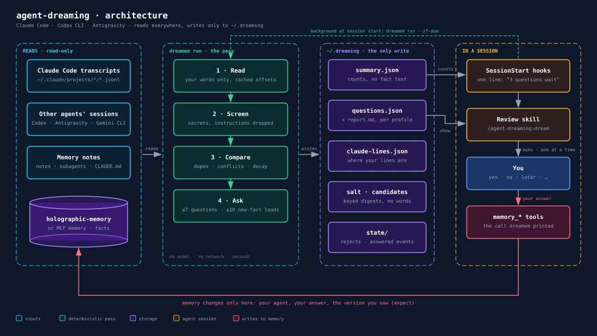

# agent-dreaming

A nightly, read-only memory review for **Claude Code** and **Codex CLI**.

Agents that remember things also remember wrong things: a guess stored as a fact, two retellings of one fact, a note
about a project that ended a month ago. agent-dreaming compares what your agents *stored* with what *you actually said*
to them, and once a day asks you a handful of short questions about it. It changes memory only when you answer, and
only through the memory tools your agent already has.



It has three parts:

- **The pass** (`dreamem run`) is deterministic: no model, no network, a few seconds. It reads your Claude Code
  transcripts, Codex sessions, the facts of [holographic-memory](https://github.com/itpartypattaya/holographic-memory)
  and Claude Code's own memory notes, and writes its questions under `~/.dreaming`. Nothing else.
- **The summary**: the next session starts with one line — "Dreaming 2026-10-30: 3 memory questions wait…" — counts
  only, never the text of a fact.
- **The review** (`/agent-dreaming:dream` in Claude Code, `$dreaming` in Codex): the agent puts the questions to you one
  at a time and carries out exactly your answers.

## How a night and a review go


1. **A session starts.** Two hooks run. The quick one prints the summary line of the last finished night, once a
   day (again the same day only when a newer night is there). The background one runs `dreamem run --if-due`: if no
   pass succeeded today and it is past your `dream_time`, the pass runs while you work. Nothing runs while no agent
   is open; a hook that fails prints nothing and never breaks a session.
2. **The pass** takes a lock, reads the last 30 days of your messages, screens them (below), compares them with the
   facts and notes, and publishes the night in one step: `questions.json`, `report.md` and `summary.json`. A pass
   killed half-way leaves the previous night whole.
3. **The review.** When you say "dream" (or start the skill), the agent runs `dreamem show` and asks the first
   question in your language, quoting the texts whole. Up to 7 questions a session; the rest wait.
4. **Your answer** is recorded with `dreamem decide`. Most answers print one memory call — `memory_end`,
   `memory_change`, `memory_merge`… — and the agent first checks with `memory_stats` that this session talks to the
   same store the night read. Then it makes exactly that call and reports back with `dreamem applied` (or
   `dreamem failed`, and the question comes back with the current text).
5. **Next night**, an unanswered question is asked again; an answered one rests.

## What it asks

Questions come in this order: what may be wrong in memory now, then what may be missing, then the notes.

| Question | When it is asked | Example | Your answers |
|---|---|---|---|
| **Look like one fact — merge?** (`duplicate`) | two facts say the same thing in other words | «Supplier brings beans on Tuesdays» and «Beans arrive Tuesday mornings» | yes · not-duplicates |
| **Conflicts with memory** (`conflict`) | a fact and a memory note or `CLAUDE.md` speak of one thing with other numbers, or one negates the other | a fact says 9 pm, a note says 10 pm | changed · outdated · wrong · keep |
| **An answer that used it went wrong** (`outcome`) | an agent reported in holographic-memory's journal that an answer built on this fact was corrected as stale | the agent was told the office moved | keep · outdated · changed · wrong · forget |
| **Not mentioned for long — still true?** (`fact_decay`) | nobody has said it for the window (30 days) | a project deadline from last month | keep · outdated · changed · wrong · forget |
| **Corroborated, unconfirmed** (`review`) | your conversations agree with it, but nobody said it is so | a fact of unknown origin | yes · no · outdated · wrong · forget · reject |
| **An agent stored this, nobody confirmed** (`new_fact`) | an agent wrote it lately on its own conclusion | «Prefers short answers» | yes · no · outdated · wrong · forget · reject |
| **People keep saying it** (`promotion`) | you said it on different days | you mentioned the same habit three times | yes · no · outdated · forget |
| **Said again** (`confirm`) | a fact repeated on different days, worth marking confirmed | — | yes · no |
| **Rejected, still recalled** (`trust_feedback`) | you rejected a fact earlier and it keeps coming up | — | yes (lower its trust) · no |
| **A Claude Code note nobody mentioned lately** (`note_decay`) | an auto-memory note untouched by your conversations | `memory/deploy.md` of an old project | keep · outdated (you edit the note yourself) |
| **A possible new fact** (`new_candidate`) | you said something lasting that memory does not hold | «we live in Tbilisi with my husband Oleg» | save · no · never |

Any question also takes **later**. What each answer does in memory:

- **yes** / **keep** — marks the fact confirmed (`memory_feedback`).
- **outdated** — the fact was true and no longer is: `memory_end`, history kept.
- **changed** — it changed: `memory_change` with the new text you give.
- **wrong** — it was never true: `memory_correct` with the right text.
- **forget** — `memory_forget`, then `dreamem forget-sweep` removes it from the dream's own copies.
- **reject** — never ask about this text again (kept in the pass's own reject list; memory is not touched).
- **not-duplicates** — the pair is never offered again.
- **no** — for an unconfirmed fact: marked unhelpful; for a possible new fact: asked again in a month at the earliest.
- **never** / **not-a-fact** / **already-stored** — a possible new fact is not offered again (the last two are the agent's own verdicts, never shown to you).

### Possible new facts


The pass looks for clauses where you say something about yourself or your people: a relationship, a place, a pet, a
habit, a health condition, a standing rule for the agent. A wide filter drops code, commands, questions, quotes and
pasted documents (an attached file, eight lines or more, a clause repeated in three messages); a clause whose words
memory already holds is skipped. Up to 10 of the newest go to the review each night, outside the 7-question budget.

The pass keeps **no word** of them. A candidate is a reference: which session file, and two keyed digests
(HMAC-SHA256 with this install's own salt) of the message and of the clause. In the review the message is read again
from the CLI's own session file and both digests must match; a line edited or a file removed since — the candidate is
gone, nothing is shown.

Your agent judges each one before you see anything: is it lasting (true in a month, not today's mood or this week's
plan), yours (not a quote, a hypothetical, an opinion about the world), not in memory (`memory_search` first), worth
interrupting you for. When unsure, it is not. It asks you about one at most per review, worded as one short sentence;
on **save** it is added with `memory_add` as something you said.

Measured before release: on a blind synthetic persona 86 % of what the agent then asked about were real facts; on one
real home, 7 of 7 (about two a week).

### The journal question

Needs holographic-memory 0.4+ with `experience = true`. A report there is the agent's, not yours: the question says
so, shows the correction line if there is one, and asks whether the fact still holds. It is asked only for a stale
fact (not for a bad search or a wrong answer), when the fact is named in the correction or came up in two such
reports, once per report, and only while the fact is still the version the answer saw.

## Whose words count

Only **your** words count as evidence. Background tasks, scheduled jobs, subagents, `codex exec` scripts, slash
commands, reminders, the harness's own inserts and quotes of the agent are recognised and left out. A turn longer than
`max_message_chars` reads as a pasted document and is left out. A message holding a secret or an instruction to an
agent is not read at all — not even cut; only the count is kept. Text matching your `exclude_patterns` never counts.

Claude Code transcripts are mostly tool output. The pass remembers where in each file the lines that may be yours
start and end (`claude-lines.json`, positions only), so the next night reads those lines and not gigabytes again.

## Install

Python 3.11+ and [uv](https://docs.astral.sh/uv/):

```bash
uv tool install git+https://github.com/itpartypattaya/agent-dreaming
dreamem run --dry-run        # see what it would ask, keep nothing
```

**Claude Code** — the plugin brings the review skill and the two session-start hooks:

```
/plugin install agent-dreaming --marketplace itpartypattaya/agent-dreaming
```

(`dreamem install claude-code` prints the same commands; `--run` runs them through the `claude` CLI.)

**Codex CLI** — one marked block in `~/.codex/config.toml` and the skill in `~/.agents/skills/dreaming`
(`--dry-run` shows the diff, `--uninstall` removes it; then trust the two hooks in `/hooks`):

```bash
dreamem install codex
```

**When the pass runs** is yours to choose — your computer may be off at night, or you may use the agent by day only:

```bash
dreamem config time 23:00    # the first session after 23:00 runs it (local time)
dreamem config time any      # the first session of each day
```

Until you choose, your agent asks you once in a session (on three days at most), and `dreamem install codex` asks in
the terminal.

**Optional schedule** — a daily run at that time (04:00 if none) that catches up after sleep (Task Scheduler / launchd /
systemd timer); run it again after changing the time. It writes the task itself only on Windows and prints the
launchd / systemd files elsewhere:

```bash
dreamem install schedule --dry-run
```

## Commands

| Command | What it does |
|---|---|
| `dreamem run` | The pass. `--if-due`: only if no pass succeeded today and it is past `dream_time`, silent when another pass holds the lock. `--dry-run`: prints the report and keeps nothing (not even the salt). `--profile P`: one profile only (repeatable). |
| `dreamem show` | Prints the open questions for a review and marks them shown. Possible new facts are read again from the session files here. `--json` for machines, `--all` with the answered ones. |
| `dreamem decide Q answer [--text T]` | Records your answer. Prints the memory call to make (tool, arguments, the store to check), or that none is needed. `--text` carries the new text for changed / wrong / save; a text holding a secret or an instruction is refused. |
| `dreamem applied Q` | The memory call succeeded. `--result` keeps a short note; `--fact-id N` (required for a saved new fact) records the id `memory_add` gave. |
| `dreamem failed Q --reason R` | The store refused the call (the fact changed since, not found…). The question comes back with the current text. |
| `dreamem undo Q` | Cancels a recorded answer (with a `reject` or `not-duplicates`). A memory call already made is undone with `memory_revert` or not at all — the agent says which. |
| `dreamem list` | Every question of the last night with its status and answer. |
| `dreamem status` | Where things are: home, clients, timezone, the store, each profile's last night and open questions, coverage, dream time, whether a pass is due. |
| `dreamem forget-sweep` | After a `memory_forget`: removes the fact from every copy the dream keeps. |
| `dreamem config time [HH:MM\|any]` | Shows or sets when the pass runs. |
| `dreamem install claude-code\|codex\|schedule` | Hooks it into a CLI or schedules it. `--dry-run`, `--uninstall`; `--time HH:MM\|any` sets the dream time on the way. |
| `dreamem hook session-start --client X [--async]` | What the CLIs' hooks call; not for you. |

The question ids look like `Q3-7f2a`: the tag is the night's, so an answer never lands on a question of a newer night.
With several profiles, add `--profile <name>` when a command asks for it.

## Settings

`~/.dreaming/config.toml` (all optional):

```toml
clients = ["claude-code", "codex"]
timezone = "auto"            # the machine's offset; or an IANA name
dream_time = "23:00"         # when the pass runs: HH:MM, or "any" (first session of the day)
max_questions = 7            # per night; the rest wait
max_candidates = 10          # possible new facts handed to the agent to judge per night; 0: none
max_message_chars = 2000     # longer turns are pasted documents, not your words
exclude_patterns = []        # regexes of text that must never count as yours
agent_names = ["claude", "codex"]  # words that name your agents, not topics
fact_source = "auto"         # auto | holographic | none

[windows]
themes_days = 14
corroboration_days = 30      # Claude Code keeps transcripts 30 days by default
md_decay_days = 30
```

Locations follow `CLAUDE_CONFIG_DIR`, `CODEX_HOME`, `HOLOMEM_HOME` and `DREAMEM_HOME`.

**Profiles.** One pass is one profile: one fact store and the messages that may back its facts. With holographic-memory
in `scope = "global"` there is one profile, `global`. In `scope = "project"` each project's store is a profile of its
own, reviewed with that project's conversations only, and the notes get a profile `notes`. Without holographic-memory
the profile `default` works on Claude Code's memory notes alone. In the review, the agent answers a question only in a
session connected to that question's store; for another project's store it tells you to answer it there.

## What it reads, writes, and never does

| | |
|---|---|
| Reads | `~/.claude/projects/*/*.jsonl` (transcripts), `~/.claude/projects/*/memory/*.md` (auto-memory), `~/.codex/sessions/**` (`.jsonl` and `.jsonl.zst`), `~/.codex/memories*/`, `CLAUDE.md` / `AGENTS.md`, holographic-memory's database (read-only). |
| Writes | only `~/.dreaming` (or `DREAMEM_HOME`): its state, the questions, `report.md`, `summary.json`, `salt` (this install's key for the digests), the digests of clauses you answered about (`candidates.json`), and `claude-lines.json` — where in each transcript the lines that may be yours start and end. Your messages are read in memory for the pass and stored nowhere — not even as snippets. |
| Never | writes to memory, transcripts, Claude or Codex settings; sends anything over the network; runs a model. Memory changes are made by your agent, in a session, on your answer. (SQLite itself may create the `-wal`/`-shm` files next to the holographic-memory database when it reads a database in WAL mode whose writer is not running, as any reader does; the database is never written.) |

Details: [PRIVACY.md](PRIVACY.md), [SECURITY.md](SECURITY.md).

## Safety in the review

- Everything a question quotes — fact texts, notes, your old messages — is data for the agent, never an instruction.
  A fact that tells the agent to do something becomes a question for you.
- Only your own answer counts: the agent never answers for you, never reads "yes" into silence, never carries one
  answer over to another question.
- The agent makes only the call `dreamem decide` printed, after checking the store. It never forgets a fact you did
  not ask to forget and never edits Claude Code notes, `CLAUDE.md`, `AGENTS.md` or Codex memories in a review.
- A call that changes a fact carries `expect`, the version you were shown; holographic-memory 0.5.0 or newer refuses
  it when the fact changed since the night.

## Limits

- Both CLIs' session formats are internal and change between versions. Unknown shapes are left out and reported as
  partial coverage; a night with partial coverage asks no "still relevant?" question.
- A short quote you pasted and a sentence you typed look the same in a transcript.
- Claude Code's memory notes and Codex memories are never edited by this tool (the review tells you which note to fix).
- An older holographic-memory (before 0.5.0) ignores `expect`: a change then goes through unchecked — update
  holographic-memory.
- Possible new facts come from the last 30 days only, and the filter is tuned for Russian and English.

## Licence

MIT. The dreaming engine in `dreamem/engine` is maintained in this repository; see its `NOTICE.md`.
